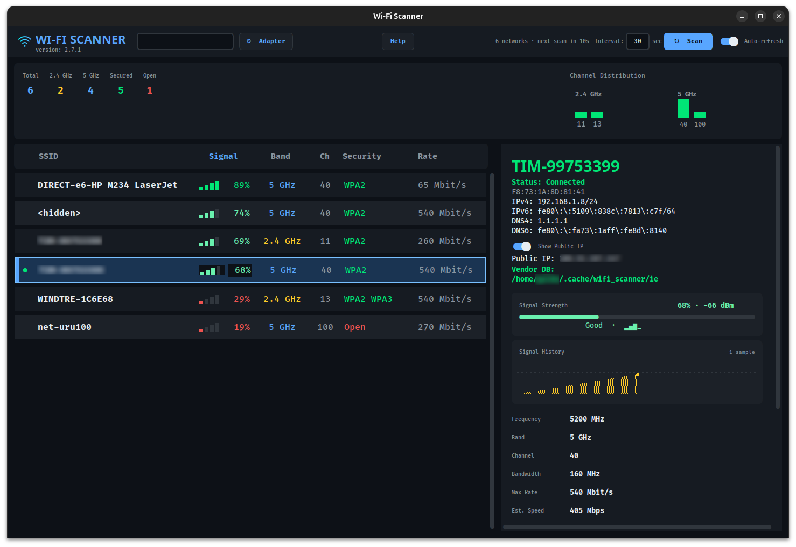
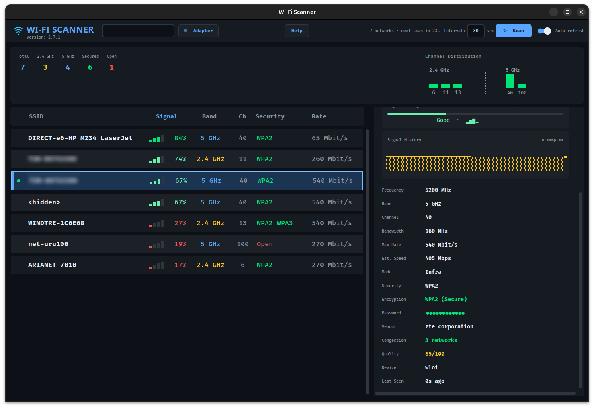

# Wi-Fi Scanner

A sleek, real-time Wi-Fi network inspector with comprehensive analysis for Linux (Ubuntu/NetworkManager).

## Requirements

### System Requirements
- Python 3.8+
- `nmcli` (comes with NetworkManager — already installed on Ubuntu)
- `iw` (recommended for WiFi adapter information) - `sudo apt install iw`
- `ethtool` (optional for driver/firmware details) - `sudo apt install ethtool`
- OUI vendor database for router/vendor detection (optional, system databases serve as fallback):
  - `wireshark-common` (provides a Wireshark `manuf` database), or
  - `ieee-data` (provides `oui.txt`, `oui36.txt`, `mam.txt`, `iab.txt`)

### Python Packages
- `customtkinter`
- `Pillow`

## Install & Run

```bash
# Install recommended system tools
sudo apt install iw ethtool

# Install an OUI vendor database for router/vendor detection
sudo apt install wireshark-common
# or: sudo apt install ieee-data

# Create and activate virtual environment
python3 -m venv venv
source venv/bin/activate

# Install Python dependencies
pip install -r requirements.txt

# Run the app
python wifi_scanner.py
```

> **Note:** No sudo required. nmcli can scan Wi-Fi as a regular user.
>
> **Vendor detection:** The app uses authoritative IEEE OUI registries. It automatically downloads
> and caches them from `standards-oui.ieee.org` to `~/.cache/wifi_scanner/ieee/` on first run.
> System databases (wireshark-common, ieee-data) serve as automatic fallback if downloads fail.

## Screenshots

### Main Window – Live Network List & Stats


### Detail Panel – Comprehensive Network Information


## Features

### Core Functionality
- **Live Wi-Fi Scanning** with automatic refresh every 15 seconds (toggleable)
- **Configurable Refresh Interval** - Set auto-refresh from 1-300 seconds
- **Real-time Filtering** - Search networks by SSID, security, or any field
- **Sortable Columns** - Click any column header to sort (signal, SSID, band, channel, security, rate)
- **Connected Network Highlighting** - Active connection shown with green indicator
- **Auto-Refresh Toggle** - Enable/disable automatic scanning with countdown timer
- **Quick Connect** - Right-click any network to connect or disconnect
  - Direct connection via NetworkManager integration
  - Password dialog for secured networks
  - Automatic use of saved passwords
  - Connect to hidden networks (not broadcasting SSID)
  - Clear status updates plus timeout/error dialogs on failures
- **Keyboard Shortcuts**
  - `Ctrl+R` manual refresh
  - `Ctrl+F` focus search
  - `Up/Down` navigate networks
  - `Enter` show selected network details
- **WiFi Adapter Information** - View comprehensive hardware details (⚙ Adapter button)
  - Device name and driver information
  - Firmware version
  - Supported frequency bands (2.4 GHz, 5 GHz, 6 GHz)
  - Supported WiFi standards (802.11a/b/g/n/ac/ax/be)
  - Transmit power level
  - Regulatory domain
  - Advanced capabilities (MU-MIMO, Beamforming, WPA3, OFDMA, etc.)
  - Requires `iw` (all features) and optionally `ethtool` (firmware version)

### Network Information Display

#### Main List View
| Column   | Description                        |
|----------|------------------------------------|
| ●        | Connected indicator (green dot)    |
| SSID     | Network name (up to 28 characters) |
| Signal   | Visual bars + percentage           |
| Band     | 2.4 / 5 / 6 GHz                   |
| Ch       | Wi-Fi channel number               |
| Security | WPA3/WPA2/WPA/WEP/Open            |
| Rate     | Maximum link rate (Mbps)           |

#### Detailed Information Panel. The detail panel is **expandable** and supports **scrolling**:

- **Connection Header**
  - Status (Connected / Not connected)
  - BSSID (AP MAC address)
  - IPv4 / IPv6 addresses (when connected)
  - DNS4 / DNS6 servers
  - Optional Public IP lookup (toggle in detail panel)
- **Signal Strength** - Percentage, dBm value, quality rating (Excellent/Good/Fair/Weak)
- **Signal History** - Sparkline chart of recent signal samples (per BSSID)
- **Frequency & Band** - Exact frequency and band classification
- **Channel & Bandwidth** - Channel number and width (20/40/80/160 MHz)
- **Speed Information**
  - Maximum Rate: Advertised link speed
  - Estimated Speed: Theoretical maximum throughput (Mbps/Gbps)
- **Network Mode** - Infrastructure or Ad-Hoc
- **Security Details**
  - Security type (WPA3/WPA2/WPA/WEP/Open)
  - Encryption type with security assessment
- **Connection Status** - Shows "Status: Connected" or "Status: Not connected"
- **Password** - Saved passwords for known networks (masked with ●●●●●●●●●●●●)
  - Click to reveal password in secure tooltip
  - 📋 Copy button to copy password to clipboard
  - Shows "Not saved" for unknown networks
- **Router Vendor** - Manufacturer identified from MAC address OUI
  - Uses authoritative IEEE OUI registries (downloaded from `standards-oui.ieee.org`)
  - Automatic fallback to system databases (wireshark-common, ieee-data)
  - Supports 40+ major vendors (Apple, TP-Link, Google, Cisco, Netgear, etc.)
  - Scrollable field for long vendor names
- **Channel Congestion** - Number of networks on the same channel
  - Color-coded: 🟢 Green (1-3), 🟡 Yellow (4-5), 🔴 Red (6+)
- **Quality Score** - Overall network quality rating (0-100)
  - Based on signal, congestion, encryption, and bandwidth
- **Device** - Network adapter used for detection
- **Last Seen** - Time since network was last detected

#### Detail Panel Scrolling
- **Vertical scrolling** - Use mouse wheel or trackpad to scroll through all fields
- **Horizontal scrolling** - Long values (like vendor names) are scrollable horizontally
- **Expandable** - The detail panel auto-expands to show all information
- **Last Seen** - Time since network was last detected

### Statistics Panel

Real-time network statistics displayed in the top panel:

- **Total Networks** - Complete count of detected networks
- **Band Distribution**
  - 2.4 GHz networks count
  - 5 GHz networks count
  - 6 GHz networks count
- **Security Overview**
  - Secured networks (with encryption)
  - Open networks (no password)
- **Channel Distribution Histogram**
  - Visual bar chart showing networks per channel
  - Color-coded congestion levels:
    - 🟢 Green: Low (1-3 networks) - optimal choice
    - 🟡 Yellow: Medium (4-5 networks) - acceptable
    - 🔴 Red: High (6+ networks) - avoid if possible
  - Helps identify least congested channels for router optimization

## UI Features

- **Modern Dark Theme** - Easy on the eyes with customtkinter
- **Large Window** - 1200×950 pixels (minimum 1000×950)
- **Readable Fonts** - 11-12pt Fira Code for clarity
- **Visual Signal Meter** - Progress bar showing signal strength
- **Color-Coded Indicators**
  - Signal quality (green/yellow/red)
  - Encryption strength
  - Channel congestion
  - Network quality score
- **Responsive Layout** - Proper spacing and alignment throughout

## Use Cases

- **Find Best Channel** - Use Channel Distribution to identify least congested channels for your router

## Vendor Detection

The app uses a multi-source approach for vendor (MAC address) detection:

1. **Authoritative IEEE Registries** (Primary) - Downloads official OUI/OUI36/MAM/IAB registries from `standards-oui.ieee.org` and caches them locally at `~/.cache/wifi_scanner/ieee/`
2. **System Databases** (Fallback) - Falls back to installed system packages (`wireshark-common`, `ieee-data`)
3. **Prefix Matching** - Supports exact /24 matches and variable-length prefix matching for comprehensive coverage

The cache is created automatically on first run. If you want to refresh the vendor database manually, delete the cache directory:
```bash
rm -rf ~/.cache/wifi_scanner/ieee/
```
The app will re-download the latest data on next run.

## Tips

- **Right-click any network** to access connection menu (Connect/Disconnect/Hidden Networks)
- **Best 2.4 GHz Channels**: 1, 6, and 11 (non-overlapping)
- **Green bars in histogram** indicate the best channels to use
- **Quality scores above 70** indicate excellent networks
- **WPA3 or WPA2** encryption is considered secure
- Click **Password** field on known networks to reveal and copy
- **Scroll the detail panel** horizontally to see full vendor names and other wide fields
- **Vendor updates** - Delete `~/.cache/wifi_scanner/ieee/` to force refresh of downloaded IEEE data

## Virtual Environment

Always activate the virtual environment before running:

```bash
source venv/bin/activate
python wifi_scanner.py
```

## License

This project is licensed under the **GNU General Public License v3.0**.
See the `LICENSE` file for the full text.

## Privacy / Personal Data

- This repository is intended to contain source code only.
- Local environment, caches, editor settings, virtual environments, and secret files are excluded via `.gitignore`.
- Before pushing, review tracked files with:

```bash
git status
git ls-files
```